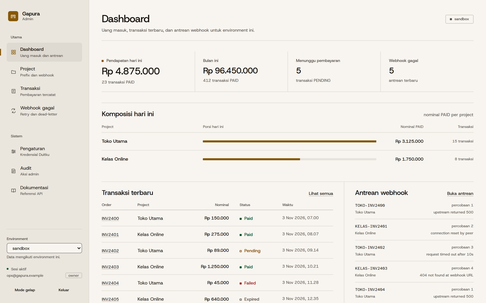
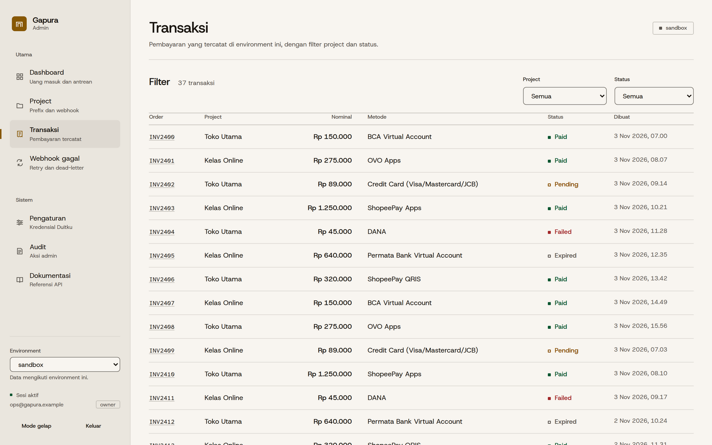
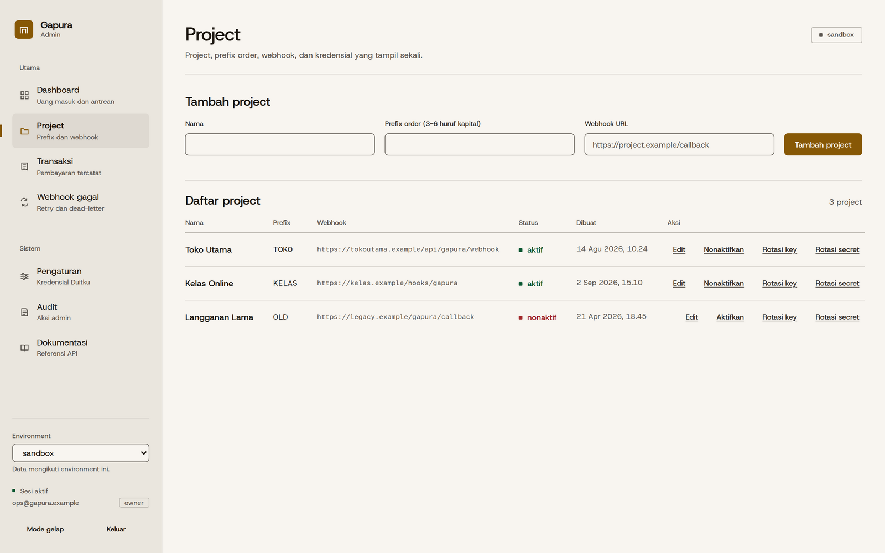
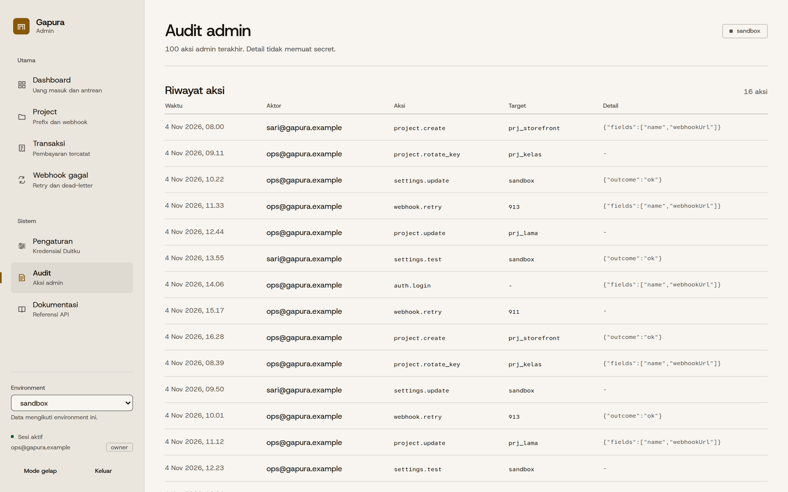
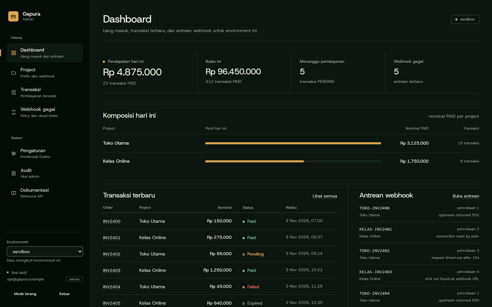

# Gapura

Backend gerbang pembayaran di Cloudflare Workers. Banyak project memakai satu akun merchant Duitku lewat Gapura; kredensial Duitku hanya ada di Gapura.

Keputusan arsitektur: [docs/adr](docs/adr).

## Preview

Panel admin dengan data demo — tidak ada kredensial atau data produksi di screenshot.



| Transaksi | Project |
|---|---|
|  |  |

| Audit | Tema gelap |
|---|---|
|  |  |

## Fitur

- **Satu API untuk banyak project** — setiap project punya prefix order dan API key sendiri; kredensial Duitku tidak dibagikan.
- **Pembuatan pembayaran idempoten** — retry dengan orderId, amount, dan paymentMethod yang sama mengembalikan transaksi lama tanpa invoice ganda.
- **Callback aman** — signature HMAC-SHA256, verifikasi nominal, transisi status sekali jalan, lalu webhook bertanda tangan ke project.
- **Webhook andal** — retry berjadwal, dead-letter, pengiriman ulang dari panel, dan sinkronisasi transaksi PENDING lewat Cron.
- **Dua environment** — `/sandbox` dan `/production` memakai D1 terpisah; kredensial Duitku disimpan terenkripsi per environment.
- **Admin yang aman** — sesi opaque + TOTP, RBAC owner/admin/viewer, CSRF, step-up reauth, recovery code, dan audit.
- **Panel operasional** — dashboard, project, transaksi, webhook, pengaturan kredensial, akun, sesi, admin, audit, dan referensi API in-app.

## Status

Berjalan di Cloudflare Workers + D1. Dua environment (`/sandbox` dan `/production`) memakai database terpisah; admin auth memakai satu database bersama. Panel React tersedia untuk operasi admin. Jalankan `pnpm verify` untuk memastikan typecheck, test, build panel, dan bundel Worker lolos.

## Struktur

```
apps/worker     Worker Hono + migrasi D1 (satu-satunya pemegang kredensial Duitku)
apps/panel      SPA React (Vite) untuk panel admin
packages/shared kode bersama: crypto, hmac, order id, status, skema Zod
```

## Prasyarat

- Node.js >= 22
- pnpm 12 (`corepack enable pnpm` bila belum ada)
- Akun Cloudflare dengan Workers + D1 (untuk deploy; dev lokal tidak perlu akun)
- Akun merchant Duitku (sandbox/production) untuk transaksi nyata

## Setup

```sh
pnpm install

# Konfigurasi Worker lokal
cp apps/worker/wrangler.toml.example apps/worker/wrangler.toml
cp .env.example apps/worker/.dev.vars
# edit apps/worker/.dev.vars: isi DUITKU_MERCHANT_CODE, DUITKU_API_KEY,
# CREDENTIALS_KEY (openssl rand -base64 32), ADMIN_SETUP_TOKEN (openssl rand -hex 32)

# Konfigurasi panel lokal
cp apps/panel/.env.example apps/panel/.env.local

# Skema D1 lokal
pnpm --filter @gapura/worker db:migrate:local
```

`apps/worker/wrangler.toml` dan semua file `.env`/`.dev.vars` diabaikan Git; hanya file `.example` yang dilacak. Untuk deploy, buat tiga database D1 dan ganti `database_id` di `wrangler.toml`:

```sh
cd apps/worker
wrangler login
wrangler d1 create gapura-auth
wrangler d1 create gapura-sandbox
wrangler d1 create gapura-production
```

`CREDENTIALS_KEY` wajib untuk enkripsi kredensial Duitku dan secret TOTP admin. `ADMIN_SETUP_TOKEN` hanya dipakai sekali untuk membuat owner pertama; hapus secret itu setelah bootstrap.

## Jalankan

```sh
# API (terminal 1)
pnpm --filter @gapura/worker dev                # http://127.0.0.1:8787

# Panel (terminal 2)
pnpm --filter @gapura/panel dev                 # http://127.0.0.1:5173
```

Buka panel, isi setup token + email + password, lalu daftarkan secret TOTP. Setelah owner aktif, buat project pertama dari halaman Project — API key hanya ditampilkan sekali.

## API

`{env}` adalah `sandbox` atau `production`; path lama tanpa prefix diperlakukan sebagai sandbox. Semua endpoint `/v1/*` memakai header `X-Gapura-Key` (API key project). Error selalu `{"error":{"code":"...","message":"..."}}`.

| Endpoint | Fungsi |
|---|---|
| `GET /health` | status Worker, tanpa auth |
| `GET /{env}/v1/me` | identitas project pemilik API key |
| `POST /{env}/v1/payments` | buat transaksi Duitku, simpan `PENDING`, kembalikan `paymentUrl`/`vaNumber`/`qrString` |
| `GET /{env}/v1/payments/:orderId` | status transaksi milik project sendiri |
| `GET /{env}/v1/payment-methods?amount=` | channel aktif + biaya dari Duitku (cache 5 menit per nominal) |
| `POST /{env}/callback/duitku` | callback Duitku; verifikasi HMAC-SHA256 + nominal, forward asinkron |
| `GET /admin/*`, `POST /admin/*`, `PATCH /admin/*`, `PUT /admin/*` | panel admin; wajib sesi cookie `__Host-gapura_admin` (HttpOnly) + `X-CSRF-Token` untuk write |
| `GET /admin/settings`, `PUT /admin/settings/:env`, `POST /admin/settings/:env/activate`, `POST /admin/settings/:env/test` | kredensial Duitku per environment (terenkripsi) |
| `GET /admin/audit` | jejak aksi admin |

Contoh:

```sh
curl -X POST http://127.0.0.1:8787/v1/payments \
  -H "X-Gapura-Key: <api-key-project>" \
  -H "Content-Type: application/json" \
  -d '{
    "orderId": "INV123",
    "amount": 150000,
    "productDetails": "Paket Premium",
    "customerName": "Budi",
    "email": "budi@example.com",
    "paymentMethod": "VC",
    "returnUrl": "https://project-a.com/thanks"
  }'
```

`paymentMethod` adalah kode 2 karakter Duitku (`VC`, `VA`, `OV`, `DA`, ...). Order ID yang dikirim ke Duitku berbentuk `PREFIX-orderId` dan unik global.

`POST /v1/payments` idempoten terhadap `orderId` project:

- Retry dengan `orderId`, `amount`, dan `paymentMethod` sama mengembalikan transaksi yang sudah ada dengan HTTP `200` + header `Idempotent-Replayed: true`; tidak ada invoice Duitku baru.
- Payload berbeda (amount/paymentMethod) untuk `orderId` yang sama ditolak `409 DUPLICATE_ORDER`.
- Bila transaksi masih dalam proses pembuatan invoice (PENDING tanpa URL/reference), balasan `409 ORDER_IN_PROGRESS` + `Retry-After: 2`; ulangi request yang sama.
- Status terminal (`PAID`, `FAILED`, `EXPIRED`) dikembalikan apa adanya. Untuk pembayaran baru setelah gagal/kedaluwarsa, pakai `orderId` baru.
- `reference` Duitku disimpan untuk jejak dan webhook, bukan kunci idempotensi; nilainya baru ada setelah inquiry berhasil.

Field pelanggan/order lanjutan bersifat **opsional** dan diteruskan apa adanya bila diisi:

| Field | Bentuk |
|---|---|
| `phoneNumber` | string maks. 50 |
| `additionalParam` | string maks. 255; dikembalikan di callback |
| `merchantUserInfo` | string maks. 255 |
| `itemDetails` | array `{name, price, quantity}`; total `price × quantity` wajib sama dengan `amount` |
| `customerDetail` | `{firstName, lastName, email, phoneNumber, billingAddress, shippingAddress}`; alamat berisi `firstName,lastName,address,city,postalCode,phone,countryCode` |

Tidak ada field yang wajib ditambahkan; project yang hanya butuh data dasar tetap memakai body lama.

## Panel admin

SPA React di `apps/panel` + endpoint `/admin/*` di Worker. Login memakai email + password Argon2id + kode TOTP. Worker mengirim token sesi 32 byte lewat cookie `__Host-gapura_admin` (`HttpOnly`, `Secure`, `SameSite=Strict`); D1 hanya menyimpan hash token dan hash CSRF. Panel tidak menyimpan token sesi di JavaScript: hanya CSRF token untuk header `X-CSRF-Token` yang disimpan di `sessionStorage`. Request baca boleh untuk semua role (`owner`/`admin`/`viewer`); write butuh `owner`/`admin`; aksi sensitif butuh TOTP ulang dalam 15 menit (`reauthenticated_at`). Bootstrap owner pertama memakai `ADMIN_SETUP_TOKEN` dan hanya bisa sekali.

```sh
pnpm --filter @gapura/panel dev   # http://127.0.0.1:5173
```

Halaman: Ringkasan, Project (buat/edit/aktif/nonaktif/rotasi), Transaksi, Webhook gagal, **Pengaturan** (merchant code + API key sandbox/production, terenkripsi AES-GCM; aktivasi environment; uji kredensial; callback URL), **Audit** (100 aksi terakhir), dan Dokumentasi in-app. Panel menampilkan email + role sesi; role `viewer` melihat data tanpa tombol write. Setiap aksi admin dicatat di tabel `admin_audit` dengan email aktor sesi.

Panel dapat dideploy ke Cloudflare Pages. Set `VITE_API_URL` dan `VITE_PANEL_URL` saat build; bila memakai host alias, isi `VITE_CANONICAL_ORIGIN` dan `VITE_ALIAS_HOST` agar panel mengalihkan ke domain kanonik sebelum React dimuat. Request admin tanpa sesi ditolak 401; write tanpa CSRF ditolak 403 `CSRF_INVALID`; aksi sensitif dengan reauth kedaluwarsa ditolak 403 `REAUTH_REQUIRED`. Langkah lengkap ada di `DEPLOYMENT.md`. Detail keputusan: [ADR-0010](docs/adr/0010-admin-auth-sesi-opaque-totp-step-up.md).

## Referensi Duitku

Kontrak vendor dipelajari dan dicatat supaya tidak menebak:

- [docs/reference/duitku-api.md](docs/reference/duitku-api.md) — endpoint, signature HMAC, parameter inquiry/callback/cek transaksi, kode error, pemetaan ke Gapura.
- [docs/reference/duitku-payment-methods.md](docs/reference/duitku-payment-methods.md) — 32 channel per sistem, expiry, void, account link, channel aktif sandbox, batas nominal/order ID.
- Katalog machine-readable: `packages/shared/src/payment-methods.ts` (dipakai panel untuk label channel).

Batas yang ditegakkan Gapura: nominal minimal Rp10.000, `merchantOrderId` maks 50 karakter, email maks 50 karakter, `paymentMethod` 2 karakter. Opsional: `expiryPeriod` (divalidasi per channel) dan `creditCardDetail` untuk `VC`. Channel aktif + biaya diambil lewat `GET /v1/payment-methods` (cache 5 menit).

## Webhook keluar

Saat status berubah, Gapura mengirim `POST` JSON ke `webhook_url` project:

```
X-Gapura-Event: payment.status
X-Gapura-Signature: t=<unix-seconds>,v1=<hex>
```

`v1 = HMAC_SHA256(<t> + "." + <body>, webhook_secret_project)`, body adalah byte JSON persis. Project wajib menolak timestamp di luar toleransi (disarankan 5 menit) dan memproses idempotent. Respons 2xx dianggap terkirim; selain itu dicatat di `webhook_logs` dengan jadwal retry (pemrosesnya menyusul di tahap retry).

Detail kontrak: [ADR-0004](docs/adr/0004-kontrak-integrasi-duitku-v2-dan-webhook-keluar.md).

## Retry dan sinkronisasi

Cron Trigger berjalan tiap menit (`[triggers]` di `wrangler.toml`) dan mengerjakan dua hal:

1. **Retry webhook** — baris `FAILED` yang `next_attempt_at`-nya lewat diklaim, dikirim ulang, lalu dicatat sebagai percobaan berikutnya. Jeda: 1m, 5m, 15m, 1j, 6j; percobaan ke-8 yang gagal menjadi `DEAD`. Pengiriman at-least-once — project wajib idempotent.
2. **Sinkronisasi pending** — transaksi `PENDING` lebih dari 10 menit dicek ke Duitku (`transactionStatus`): `00` → `PAID`, `02` → `EXPIRED`, `01` → tetap. Hanya perubahan yang diteruskan ke webhook.

Riwayat `DELIVERED`/`DEAD` lebih tua dari 30 hari dipangkas otomatis; `FAILED` yang masih terjadwal tidak disentuh.

Detail: [ADR-0005](docs/adr/0005-retry-webhook-dan-sinkronisasi-status-via-cron.md). Uji Cron lokal:

```sh
pnpm --filter @gapura/worker dev -- --test-scheduled
curl "http://127.0.0.1:8787/__scheduled?cron=*+*+*+*+*"
```

## Test dan verifikasi

```sh
pnpm verify
```

Menjalankan typecheck semua paket, test `packages/shared` dan `apps/worker`, build panel, dan bundel Worker (`wrangler deploy --dry-run`) tanpa mengunggah apa pun.

Test Worker memakai harness HTTP + repository in-memory untuk logika, SQL asli (`node:sqlite`) untuk repository/migrasi, dan klien Duitku palsu untuk jalur HTTP vendor. Alasan pilihan ini ada di [ADR-0003](docs/adr/0003-test-memakai-vitest-plus-sqlite-asli-bukan-minifla.md).

## Deploy

Langkah lengkap dan rollback ada di [DEPLOYMENT.md](DEPLOYMENT.md), triage di [RUNBOOK.md](RUNBOOK.md). Ringkas:

1. Isi `database_id` ketiga D1 di `apps/worker/wrangler.toml`.
2. `wrangler d1 migrations apply <nama-db> --remote` untuk auth, sandbox, dan production.
3. Set `PUBLIC_BASE_URL` ke URL Worker, lalu `wrangler deploy`.
4. `wrangler secret put DUITKU_MERCHANT_CODE`, `DUITKU_API_KEY`, `CREDENTIALS_KEY`, dan `ADMIN_SETUP_TOKEN`.
5. Build panel dengan `VITE_API_URL` yang menunjuk ke Worker, lalu deploy ke Pages.

Hanya layanan Cloudflare free tier yang dipakai (Workers, D1, Cron Trigger). Tanpa Queues/R2.

## Keamanan

Repo ini menangani transaksi pembayaran dan data pembeli (nama, email). Jangan commit secret Duitku, API key project, atau webhook secret. API key project disimpan sebagai hash SHA-256; key mentah hanya ditampilkan sekali saat dibuat (tahap panel admin). Laporan celah: [SECURITY.md](SECURITY.md). Ancaman dan checklist: [docs/SECURITY_CHECKLIST.md](docs/SECURITY_CHECKLIST.md). Jalankan `pnpm security` untuk memeriksa dependency.

## Bekerja dengan pakem

```sh
python3 .pakem/pakem.py start "<goal>"
python3 .pakem/pakem.py check
python3 .pakem/pakem.py finish --summary "<hasil + bukti>"
```

Routing konteks lengkap: [.pakem/CONTEXT.md](.pakem/CONTEXT.md).
